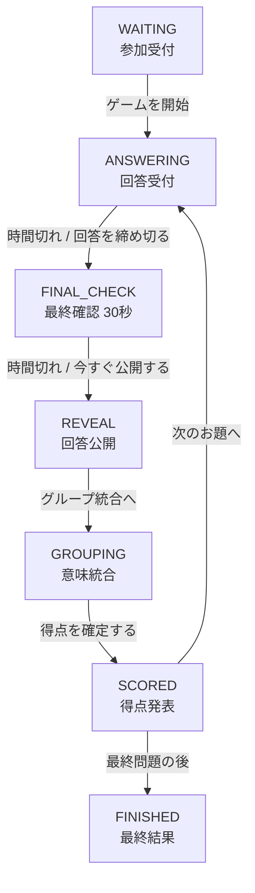

# 司会者・運営向け 利用ガイド

以心伝心ゲームを進行する方向けの説明書です。  
参加者のスマホ、司会者PC、会場スクリーンの3つを連携させます。

- 所要時間: 約30〜45分（お題数によります）
- 司会者PC: Google Chrome / Microsoft Edge 推奨
- 会場スクリーン: 16:9（1920×1080 推奨）
- 参加者: スマートフォン。アプリのインストールは不要

> 参加者に配る説明は [GUIDE-PLAYER.md](./GUIDE-PLAYER.md) をそのまま使えます。

---

## 1. 全体像

| 役割 | 画面 | URL |
|---|---|---|
| 司会者 | 進行管理 | `/host` |
| 司会者 | お題管理 | `/host/questions` |
| 会場スクリーン | ステージ表示 | `/stage?token=...` |
| 参加者 | 参加・回答 | `/play?code=（ルームコード）` |
| 運営 | ヘルスチェック | `/api/health` |

- 司会者PC 1台で、進行管理とスクリーン表示を兼ねられます
- スクリーンは司会者画面の「スクリーン」リンクから別ウィンドウで開き、会場モニターへミラーします
- 司会者も選手として参加できます

---

## 2. 事前準備

### 2-1. 1週間前まで

- [ ] 本番URLが開ける
- [ ] `/api/health` が `ok` を返す
- [ ] `store.backend` が `supabase` になっている（本番の場合）
- [ ] 司会者キーを本番用に変更した
- [ ] ルームコードを決めた
- [ ] チーム数と1チームの定員を決めた
- [ ] お題を8問程度用意した
- [ ] 会場Wi-Fiでスマホから接続できるか確認した

### 2-2. 前日

- [ ] `npm test` / `npm run lint` / `npm run build` が成功
- [ ] 本番URLでリハーサルを1周した
- [ ] スクリーンURLの `token` を控えた
- [ ] 予備の司会者端末を用意した
- [ ] 進行状態のバックアップを取得した

### 2-3. 当日の持ち物

- [ ] 司会者PC（電源アダプター付き）
- [ ] HDMIケーブル・変換アダプター
- [ ] 予備のスマートフォン
- [ ] モバイルルーター（会場Wi-Fiの予備）
- [ ] 電源タップ

---

## 3. 司会者ログイン

### 方法A: URLでキーを渡す

```text
https://（本番URL）/host?key=（司会者キー）
```

初回だけこのURLで開きます。ログイン後はキーがCookieに保存され、URLからキーは自動で消えます。

### 方法B: ログイン画面で入力する

```text
https://（本番URL）/host
```

「司会者ログイン」画面でキーを入力します。

- ログインの有効期限は12時間です
- 別のPC・別のブラウザでは、もう一度ログインが必要です
- キーを忘れた場合は、Vercelの環境変数 `HOST_KEY` を確認してください

---

## 4. 参加受付とチーム編成

### 4-1. 参加者の入り方

会場スクリーンの待機画面にQRコードが表示されます。参加者が読み取ると、参加画面が開きます。

参加者は次の3つを入力します。

1. ルームコード（QRから開いた場合は自動入力）
2. 名前（20文字以内。本名でもニックネームでも可）
3. チーム（満員のチームは選べません）

### 4-2. チームを調整する

司会者画面の「チーム編成」で調整できます。**調整できるのはゲーム開始前だけ**です。

- **定員を増減**: 各チームの `−` / `+`
- **チームを追加**: 「チームを追加」（2〜10チーム）
- **参加者を移動**: 参加者名の横のセレクトで移動先を選ぶ

> 開始後にチームを追加したり、参加者を移動したりする画面はありません。  
> 開始前に人数を確認してください。

### 4-3. 司会者も選手として参加する

開始前に「進行担当も選手として参加」から、名前とチームを選んで登録します。  
登録すると、司会者PCの画面にも回答欄が表示されます。

### 4-4. 参加状況の確認

- チームごとの `回答済み / メンバー数` が表示されます
- 全員が揃わなくても開始できます
- 遅刻・途中参加の人は、ゲーム終了前ならいつでも参加できます

---

## 5. お題の登録

`/host/questions` を開きます。ゲーム開始前だけ編集できます。

| 項目 | 制限 |
|---|---|
| お題の文字数 | 1〜100文字 |
| 制限時間 | 10〜600秒（整数） |
| お題数 | 1〜50問 |

- 追加・編集・削除・並べ替えができます
- 上から順に出題されます
- 保存するとすぐに参加者・司会者・スクリーンへ反映されます
- **ゲームを開始すると凍結され、変更できなくなります**

> 開始後にお題を変えるには、最終結果まで進めて「ゲームをリセット」し、お題管理へ戻る必要があります。進行中の回答・得点は消えるため、本番では開始前の確認が必須です。

### お題作りのコツ

- 正解・不正解がない、自由記述に向くお題にする
- 短く、誰でも同じ言葉を思いつくお題にする
- 「〜といえば？」の形が揃いやすい
- イベント固有のネタは、事前に内容を確認しておく
- 1問あたり60〜90秒が目安

---

## 6. ゲームの流れ



### 6-1. 開始

1. 参加者とチームを確認する
2. お題が正しいことを確認する
3. 「ゲームを開始」を押す

開始と同時に、お題が凍結され、第1問の回答時間が始まります。

### 6-2. 回答受付中

- 残り時間と、チームごとの回答人数が表示されます
- 参加者は締切まで何度でも回答を修正できます
- 全員が揃わなくても「回答を締め切る」で次へ進めます
- 時間切れの場合は、自動で最終確認へ進みます

> 自動遷移は、次に画面が状態を取得したタイミングで反映されます。  
> 最大1.5秒程度の遅れが出ることがあります。

### 6-3. 最終確認（30秒）

回答締切後、公開前に30秒間の最終確認があります。

- 参加者には自分の回答だけが表示されます
- 参加者はこの時間内なら回答を修正できます
- 司会者は `−30秒` / `＋30秒` で調整できます
- 準備ができたら「今すぐ公開する」で公開します

> 時間切れの場合は、自動で回答公開へ進みます。  
> `＋30秒` を押しても、現在時刻から180秒を超えることはありません。

### 6-4. 回答公開

- 全チームの回答グループと人数が表示されます
- 参加者・スクリーンにも同じ内容が表示されます
- 公開後に回答を変更することはできません

### 6-5. グループ統合

意味は同じでも字面が違う回答を、司会者の判断でまとめられます。

1. 「グループ統合へ」を押す
2. チームを選ぶ
3. 統合する回答を2つ以上選ぶ
4. 統合後の回答名（20文字以内）を入力する
5. 統合理由（40文字以内）を入力する
6. 「統合する」を押す

- 統合できるのは**同じチーム内**だけです
- 統合の理由は、全チームの画面に表示されます
- 「統合を取り消す」で元に戻せます
- 統合してから得点を確定してください

#### 統合の例

| 統合後の回答名 | 統合理由 |
|---|---|
| カレー | カレーライス・カレーと同じ料理のため |
| ビール | 生ビール・瓶ビールを同じ飲み物として扱うため |
| 温泉 | 温泉旅行・温泉宿を同じ目的として扱うため |

> 統合は得点に影響します。迷った場合は、統合せずにそのまま確定しても構いません。  
> 理由は参加者にも読まれるため、簡潔で分かりやすい言葉にしてください。

### 6-6. 得点確定

「得点を確定する」を押すと、そのお題の得点が計算されます。

- 得点 = 最大グループの人数 ÷ 回答者数 × 10（四捨五入）
- 回答者4人未満のチームは「採点対象外」
- 確定後の変更はできません

### 6-7. 次のお題 / 最終結果

- 最終問題でなければ「次のお題へ」
- 最終問題なら「最終結果を表示」

最終結果では、総得点・全員一致の回数・最終お題の得点・抽選で順位が決まります。

---

## 7. 得点と順位のしくみ

### 7-1. 得点

```text
得点 = 最大グループの人数 ÷ そのお題の回答者数 × 10
（四捨五入して0〜10点）
```

- 回答者数は、そのお題に回答した人数です
- 未回答・欠席の人は含まれません
- 回答者4人未満のチームは採点対象外です（0点ではありません）
- 統合したグループは、合計人数で数えます

### 7-2. 同点順位

最終順位は、次の順で決まります。

1. 総得点
2. 全員一致（10点）の回数
3. 最終お題の得点
4. 抽選

抽選はゲーム終了時に自動で行われます。  
ゲーム中の順位表示では、総得点が同じチームは同じ順位で並びます。

---

## 8. 終了後

### 8-1. 最終結果を残す

- スクリーンには最終結果が表示されたままになります
- 写真を撮る場合は、参加者の名前が写ることに注意してください

### 8-2. もう一度遊ぶ（同じメンバー）

最終結果画面の「ゲームをリセット」を押します。

- 参加者・チーム・お題は残ります
- 回答・統合・得点・順位は消えます
- フェーズは `WAITING` に戻り、お題の凍結も解除されます

### 8-3. イベントを完全に終える

最終結果画面の「参加者も含めて初期化」を押します。

- 参加者・回答・統合・得点がすべて消えます
- お題とチームは残ります
- 次のイベントですぐ使える状態になります

> リセット系のボタンは**最終結果画面にだけ**表示されます。  
> ゲーム進行中に誤って押す心配はありません。

### 8-4. 本番後にイベント固有のお題を消す

イベント固有のお題を使った場合は、最終結果を保存してから初期化し、お題を汎用の内容へ戻してください。  
詳しい手順は [OPERATIONS.md](./OPERATIONS.md) を参照してください。

---

## 9. トラブル対応

| 症状 | 確認・対応 |
|---|---|
| 司会者画面が401 | `HOST_KEY` と入力したキーが一致しているか。`/host?key=...` で開き直す |
| スクリーンが401 | `STAGE_REQUIRE_TOKEN=1` の場合、`?token=` 付きのURLが必要 |
| 参加できない | ルームコードが合っているか。チームが満員でないか。Cookieが有効か |
| 参加者の画面が「通信が不安定」 | Wi-Fiを確認。自動再接続する。改善しなければ再読み込み |
| 司会者画面に「画面の状態が古い」 | `PHASE_CONFLICT`。画面を再読み込みすると現在の状態に追従する |
| 回答が反映されない | 参加者に「送信済み」が出ているか確認。司会者画面を再読み込み |
| スクリーンだけ止まる | スクリーンを再読み込み。`token` 付きURLを開き直す |
| 操作が「混み合っています」 | 30人一斉回答時の一時的な競合。数秒待って再操作する |
| 司会者PCが落ちた | 別PCで `/host?key=...` を開く。状態はサーバー側に残っている |
| 参加者の電池が切れた | 同じ名前・同じチームで再参加。回答は再送する |
| Supabaseが停止した | 復旧を待つ。難しければローカルファイル保存へ切り替える（下記） |

### ローカルへの切り替え

Supabaseが使えない場合の最終手段です。会場Wi-Fi内で完結します。

```powershell
cd C:\Users\hirat\projects\nomikai-app
npm run build
npm start
```

- 表示された `http://192.168.x.x:3000` を参加者に配ります
- 状態は `.data/game-state.json` に保存されます
- **既知の制約**: 本番ビルドはCookieに `Secure` を付けるため、`http://` のLAN接続ではスマホの参加Cookieが保存されない場合があります。この場合は `npm run dev` で起動するか、`COOKIE_SECURE=0` 相当の対応が入るまで待ってください

---

## 10. 当日チェックリスト

### 開始30分前

- [ ] 司会者PCを電源に接続
- [ ] スクリーンをHDMIで接続し、1920×1080で表示
- [ ] `/api/health` が `ok`
- [ ] `/host?key=...` でログイン
- [ ] スクリーンリンクを開き、QRコードが表示される
- [ ] スマホ1台で参加テスト
- [ ] お題が本番用で、開始前（変更可）である
- [ ] チーム数・定員が想定どおり

### 開始5分前

- [ ] 参加者がQRで参加済み
- [ ] 各チームに均等に分かれている
- [ ] 司会者も選手として参加済み（参加する場合）
- [ ] スクリーンにルームコードとQRが出ている
- [ ] 参加者に「画面を閉じない」よう案内した

### 終了後

- [ ] 最終結果を保存した
- [ ] 必要なら「ゲームをリセット」または「参加者も含めて初期化」
- [ ] イベント固有のお題を汎用の内容へ戻した
- [ ] スクリーンURLを閉じた

---

## 11. 画面URL一覧

```text
参加者          /play?code=4821
司会者          /host
司会者ログイン  /host?key=（司会者キー）
お題管理        /host/questions
スクリーン      /stage?token=（スクリーントークン）
ヘルスチェック  /api/health
```

- `?preview=1` を付けると、実データを使わない画面確認モードになります
- 本番では `?preview=1` を付けないでください

---

## 12. 困ったときは

まず `/api/health` を確認してください。

```json
{
  "ok": true,
  "store": { "backend": "supabase" },
  "region": "hnd1",
  "commit": "xxxxxxx"
}
```

- `ok` が `false`、または画面が500を返す場合は、Vercelのデプロイ状況を確認します
- `store.backend` が `file` の場合は、Supabaseの環境変数が読まれていません
- 復旧できない場合は、予備端末・ローカル環境・バックアップを使ってください

実装の詳細は [SPEC.md](./SPEC.md)、本番手順は [OPERATIONS.md](./OPERATIONS.md) を参照してください。
