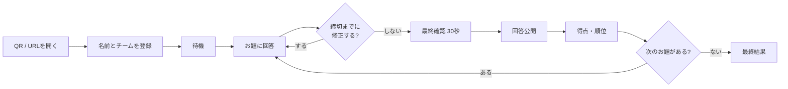

# 参加者向け 利用ガイド

以心伝心ゲームを、スマートフォンから参加する方向けの説明書です。  
むずかしい操作はありません。QRコードを読んで、名前とチームを選ぶだけです。

- 所要時間: 約30〜45分（お題数によります）
- 必要なもの: スマートフォン1台、会場のWi-Fi、ブラウザ（Safari / Chrome など）
- アプリのインストール: 不要
- カメラ・マイク・位置情報: 使いません

---

## 1. どんなゲーム？

チーム対抗で、同じお題に答えます。  
**チームの答えがどれだけ揃ったか**を競うゲームです。正解・不正解はありません。

- お題は司会者が出します（例: 「冬の定番料理といえば？」）
- 回答は20文字以内の自由記述
- チームの回答が1つにまとまるほど高得点
- 全員一致なら、人数に関係なく10点満点

> ポイントは「チームの人が同じ答えを書けそうか」を考えることです。  
> 難しい言葉より、短くて誰でも思いつく答えのほうが揃いやすくなります。

---

## 2. 参加のしかた

### ステップ1: QRコードを読み取る

会場スクリーンに表示されているQRコードを、スマートフォンのカメラで読み取ります。

QRコードが使えない場合は、司会者から共有された参加用URLを開くか、ブラウザでURLを入力してください。

```text
https://（会場のURL）/play?code=（ルームコード）
```

### ステップ2: ルームコード・名前・チームを入力する

| 項目 | 内容 |
|---|---|
| ルームコード | QRコードから開いた場合は自動で入っています |
| 名前 | 表示したい名前。本名でもニックネームでもOK（20文字以内） |
| チーム | 参加するチームを1つ選ぶ。満員のチームは選べません |

- 同じ名前の人がいる場合は、自動で「 2」「 3」などの番号が付きます
- チームは司会者が決めた数だけ表示されます
- 満員のチームには「満員」と表示され、選択できません

### ステップ3: 「参加する」を押す

「参加登録ができました」と表示されたら参加完了です。  
**ゲームが終わるまで、この画面を開いたままにしてください。**

---

## 3. ゲームの流れ



---

## 4. 画面ごとの操作

### 4-1. 待機画面

- 参加登録ができたこと、自分のチーム、チームの参加状況が表示されます
- 司会者が「ゲームを開始」すると、自動でお題の画面に切り替わります
- 待っている間は、画面を閉じたり再読み込みしたりしないでください

### 4-2. 回答画面

1. お題を確認する
2. 回答を20文字以内で入力する
3. 「回答する」を押す
4. 「送信済み」と表示されたら完了

- 回答は**締切まで何度でも修正できます**
- 修正するときは「回答を修正する」を押します
- 入力欄の下に「〇 / 20文字」と文字数が表示されます
- 画面下に「回答済み」「未回答」の人数が出ます

> 回答は公開されるまで、他の人には見えません。  
> 他のチームの回答も、公開前は見えません。

### 4-3. 最終確認（30秒）

回答締切後、公開前に**30秒間の最終確認**があります。

- この時間は、自分の回答だけが表示されます
- 他の人・他のチームの回答は見えません
- 回答を変えたい場合は「回答を修正する」から変更できます
- 変更したら「この内容で確定」を押します
- 「確定」は意思表示です。押さなくても、時間になれば自動で公開されます
- 確定後も、公開までは何度でも修正できます

> 30秒は司会者が「＋30秒」「−30秒」で調整する場合があります。  
> 画面のカウントダウンを確認してください。

### 4-4. 回答公開

- 全チームの回答が一覧で表示されます
- 自分の回答と、チームごとの回答グループ・人数が見られます
- 司会者が意味の同じ回答を統合すると、統合後の名前と理由が表示されます
- 公開後に回答を変更することはできません

### 4-5. 得点・最終結果

- お題ごとの得点、一致率、総合順位が表示されます
- 最終問題が終わると「最終結果」が表示されます
- 自分のチームの順位・得点・全員一致の回数も確認できます
- 採点対象外のチームは「採点対象外」と表示されます（0点とは別扱いです）

---

## 5. 得点のしくみ

得点は、**チームの回答者数に対して、最も多い回答グループが何割を占めたか**で決まります。

```text
得点 = 最大グループの人数 ÷ そのお題の回答者数 × 10
（四捨五入して0〜10点）
```

### 例: 6人が回答した場合

| 回答の内訳 | 最大グループ | 得点 |
|---|---|---|
| 6人全員が同じ | 6人 | 10点 |
| 5人が同じ、1人が別 | 5人 | 8点 |
| 4人が同じ、2人が別 | 4人 | 7点 |
| 3人が同じ、3人が別 | 3人 | 5点 |
| 2人が同じ、4人が別 | 2人 | 3点 |
| 全員バラバラ | 0人 | 0点 |

### 採点対象外になることがあります

そのお題の**回答者が4人未満**のチームは、採点対象外になります。  
0点ではなく「採点対象外」と表示されます。

- 欠席・未回答の人は、回答者数に含まれません
- 途中参加の人は、参加したお題から回答者数に含まれます
- 4人未満でもゲームは進みます。次のお題で挽回できます

### 表記ゆれは自動でまとまります

次の違いは、システムが自動で同じ回答として扱います。

- 全角・半角（例: 「カレー」と「ｶﾚｰ」）
- 前後の空白、言葉の間の空白
- カタカナ・ひらがな（例: 「すし」と「スシ」）
- 大文字・小文字
- 末尾の句読点（例: 「カレー。」と「カレー」）

意味が同じでも字面が違う場合（例: 「カレー」と「カレーライス」）は、司会者が理由を付けて統合することがあります。統合の理由は全チームに表示されます。

---

## 6. よくある質問

### Q. 遅刻してしまいました。途中から参加できますか？

参加できます。ゲーム終了前であれば、いつでも参加登録できます。  
回答受付中のときは、そのお題から回答できます。最終確認中でも、時間内なら回答できます。

### Q. 画面を閉じてしまいました。戻れますか？

同じスマートフォン・同じブラウザで参加用URLを開き直してください。  
参加情報が残っていれば、自動で元の画面に戻ります。

ブラウザのCookieを消した場合は、同じ名前・同じチームで再参加してください。  
同じ名前の場合、自動で番号が付きます。

### Q. 通信が不安定です

画面に「通信が不安定です。自動で再接続します」と表示された場合は、そのまま待ってください。自動で再接続します。

改善しない場合は、会場のWi-Fiに接続しているか確認し、ページを再読み込みしてください。

### Q. 回答を変えたいです

- 回答受付中: 「回答を修正する」から何度でも変更できます
- 最終確認中: 同じく変更できます。変更後は「この内容で確定」を押してください
- 回答公開後: 変更できません

### Q. チームが満員で選べません

別のチームを選んでください。  
どのチームも満員の場合は、司会者に「定員を増やす」か「チームを追加する」よう伝えてください。

### Q. 同じ名前の人がいます

システムが自動で「 2」「 3」などの番号を付けます。  
自分がどれか分からない場合は、待機画面の「あなたのチーム」と名前を確認してください。

### Q. 何を答えればいいですか？

正解はありません。  
「チームの人が同じことを言いそう」と思う、短くて分かりやすい答えがおすすめです。

### Q. 回答が反映されません

1. 「送信済み」と表示されているか確認する
2. 画面を再読み込みする
3. それでも直らない場合は、司会者に伝える

### Q. 写真や音声は使いますか？

使いません。文字の回答だけです。  
アプリのインストールも不要です。

### Q. 途中で抜けてもいいですか？

構いません。回答済みの内容は残ります。  
ただし、チームの枠は残るため、復帰する場合は同じ端末で開き直してください。

### Q. 名前は本名でないとだめですか？

本名でもニックネームでも構いません。  
ただし、他の参加者にも表示されるため、イベントのルールに従ってください。

---

## 7. 司会者・幹事向け: 当日の案内文テンプレート

参加者に送る案内文の例です。`（ ）` の部分を当日の内容に置き換えてください。

```text
【以心伝心ゲーム 参加のお願い】

本日は「以心伝心ゲーム」を行います。
スマートフォンで、下記のURLまたは会場のQRコードから参加してください。

参加URL: （https://.../play?code=...）
ルームコード: （....）

・名前とチームを選んで「参加する」を押してください
・ゲームが終わるまで、画面を開いたままにしてください
・回答は20文字以内。締切まで何度でも修正できます
・回答は公開されるまで、他の人には見えません

所要時間: 約（30〜45）分
```

---

## 8. 困ったときは

まずは近くの幹事・司会者に声をかけてください。  
画面のエラー表示をそのまま見せてもらえると、原因を特定しやすくなります。

- 参加できない
- チームが満員
- 通信が不安定
- 回答が反映されない
- 画面が元に戻らない

以上です。楽しんでください！
